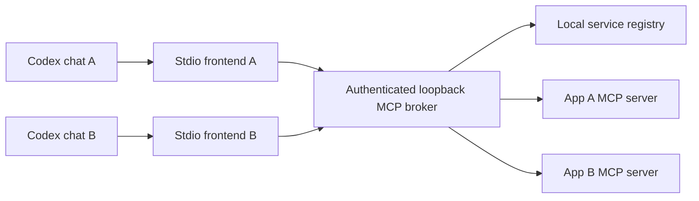

# CodexMCPBroker

Local MCP service discovery and routing for one reusable Codex plugin

Connect multiple Codex chats to independently installed app services through a shared local broker. An app supplies its MCP endpoint and a service registration; refreshing the catalog makes its tools discoverable without changing the Codex plugin.

The plugin is named **Universal Tools**. The Python distribution and CLI retain the names `universal-codex-tools` and `universal-tools` for package and command compatibility. The current version is **0.10.0**.

**Status: experimental and under active development. This tool is not mature or production-ready.** It is an optional broker experiment, and is **not currently required** by the MCPServer repositories maintained under [votecoffee](https://github.com/votecoffee). Those projects continue to use their existing direct MCP integrations. Full app workflow parity and migration readiness have not been established; retain the direct integrations while broker compatibility work continues.

## Table of Contents

- [Background](#background)
- [Install](#install)
- [Usage](#usage)
- [Architecture](#architecture)
- [Limitations](#limitations)
- [API](#api)
- [Maintainers](#maintainers)
- [Contributing](#contributing)
- [License](#license)

## Background

Apps own their tools, native processes, data and authorization. CodexMCPBroker provides a common discovery and routing layer so each new app can register with the existing plugin.

The broker exposes fourteen fixed tools. App tools are namespaced catalog entries selected through search and description. Opt-in app catalog providers also make inner capabilities searchable behind those outer tools. Neither becomes an individual native Codex tool definition. Separate chats share the broker, while each chat connects through its own stdio frontend. Integrations can opt into an exclusively owned context or a retained shared adapter for an app-owned service.

## Install

### Dependencies

- Windows and PowerShell. Windows with Python 3.13 is the validated development environment.
- Python 3.11 or newer with the Windows `py` launcher; setup defaults to Python 3.13.
- Git to clone the source, and a Codex installation with the `codex plugin` CLI commands available.

From PowerShell:

```powershell
git clone https://github.com/votecoffee/CodexMCPBroker.git
Set-Location CodexMCPBroker
.\scripts\Setup.ps1
.\scripts\Install-Plugin.ps1
```

Setup installs locked runtime dependencies into `.local/runtime`, initializes private broker state under `.local`, and writes an ignored plugin runtime pointer. Installation registers the local marketplace and adds `universal-tools@universal-tools-local`. Start a new Codex chat to load the plugin. No OpenAI API key is required by the broker.

To select another installed Python version, pass `-PythonVersion` to `Setup.ps1`. After broker code changes, stop the broker and rerun setup. After plugin package changes, rerun installation. Adding an app registration requires a catalog refresh.

## Usage

### CLI

Run these commands from the repository root:

```powershell
.\scripts\Broker.ps1 start
.\scripts\Broker.ps1 status
.\scripts\Broker.ps1 list
.\scripts\Broker.ps1 refresh
.\scripts\Broker.ps1 stop
```

A plugin frontend also starts the broker when needed. Closing a chat leaves the shared broker available to other chats. Normal startup connects to registered apps; each HTTP app manages its own process lifecycle.

### Try the example services

```powershell
.\scripts\Broker.ps1 start-demo
.\scripts\Broker.ps1 list
```

The demonstration starts example math and notes services. Default loopback ports are 8768 for the broker, 8769 for math and 8770 for notes; setup can select a different broker port. The demo supervisor stops its example processes when the broker exits.

In a new Codex chat, ask:

> Use Universal Tools. Refresh services, find and describe the example math add tool, and calculate 12 + 30.

### Register an app

Copy a descriptor into the ignored local directory, then edit its app ID, endpoint and policy:

```powershell
Copy-Item .\examples\app-http.service.json .\.local\my-app.service.json
notepad .\.local\my-app.service.json
.\scripts\Register-App.ps1 -Manifest .\.local\my-app.service.json
.\scripts\Broker.ps1 refresh
```

Use [app-http.service.json](examples/app-http.service.json) for an MCP Streamable HTTP endpoint on literal loopback. Use [app-stdio.service.json](examples/app-stdio.service.json) for a stateless stdio adapter. Existing REST endpoints need an MCP adapter.

For an integration that needs state across calls, review [app-exclusive.service.json](examples/app-exclusive.service.json) and the ownership contract before registration. Persistence is opt-in; existing registrations keep their transient lifecycle.

Registration is a local administrative action: it authorizes connecting to the endpoint or launching the configured executable. The broker scans its registration directory; app installers can use the same registration command. It does not automatically discover arbitrary installed applications.

See the [app integration contract](APP_CONTRACT.md) and [registration schema](examples/service.schema.json) for authentication, lifecycle, ownership and validation requirements.

### Invoke tools

Search for a tool, use `describe_service` for its app's initialization guidance and capabilities, then `describe_tool` for its schema and `catalog_revision`. Invoke it with that revision and schema-valid arguments. Writes also require a unique `request_id`. The broker checks the live definition before dispatch; changed registrations or definitions require another refresh/describe cycle.

`describe_service` returns the app's negotiated protocol version, server information, advertised capabilities and optional instructions, alongside the broker's actual relay support. This is attributed, untrusted app data. It cannot authorize unrelated actions or change broker policy. The catalog snapshot comes from discovery; after acquiring an exclusive context, describe the service again to inspect that session's guidance. Only its active owner receives the session snapshot. Other frontends receive the earlier catalog snapshot, which refresh preserves while the context is owned. Description does not connect to the app or renew a lease.

Registrations default to `allow_writes: false`. Tools need `readOnlyHint: true` for the read channel, except exact legacy tool names reviewed under `read_only_tools`. An explicit false annotation always uses the write channel. App-specific permissions and review requirements remain authoritative.

### Discover inner capabilities

Broker 0.8 adds an optional [versioned catalog provider](docs/capability-catalog.md). A registration names a read-only metadata tool that returns a normalized catalog. For unowned services, `refresh_services` queries it and indexes capability IDs, descriptions and tags. Existing apps are unchanged unless explicitly registered with a compatible provider; a tool named `list_capabilities` is not automatically assumed compatible.

`search_tools` distinguishes `kind: "tool"` from `kind: "capability"`; use its `kind` argument to filter either or search `"all"`. Capability results are discovery-only, with `callable: false`. Pass their `capability_revision` to `describe_capability`, inspect the referenced native discovery tool with `describe_tool`, then use the read channel to retrieve the app's current inner schema and workflow. Native calls still use outer tool IDs and their broker revisions; app catalog and target/review revisions remain independent.

After acquiring an exclusive service, call `refresh_capabilities(service_id, context_id)` to index its owned session. Only that frontend sees its catalog; other frontends keep the earlier public snapshot. Global refresh does not probe or publish the owner's catalog. Capability description is observational; a successful owned provider probe renews the lease. Invalid catalogs lose their hints, and transport failures keep normal recovery barriers. Refresh never reloads app extensions or distributes app skills.

### Scope pilot access and payloads

Broker 0.7 adds optional local registration fields for selected writes and larger arguments. For a disposable pilot, review the actual app tool names and payload requirements before setting, for example:

```json
{
  "allow_writes": true,
  "allowed_write_tools": ["prepare_change", "apply_change"],
  "max_argument_bytes": 2097152
}
```

This is a descriptor fragment, not a registration command. `allowed_write_tools` contains exact, case-sensitive outer MCP tool names without the service prefix. It applies only when `allow_writes` is true. An empty list disables all writes; omission or `null` preserves the existing service-wide write flag. A newly advertised write-capable tool stays blocked unless named in a configured list. This does not change read/write classification or filter operations inside an extension wrapper; apps must enforce their inner operation policy.

`max_argument_bytes` defaults to 262,144 and accepts 1–8,388,608 bytes. It measures the entire argument object encoded as compact UTF-8 JSON, including base64 and JSON escaping. The broker HTTP envelope has a separate 10 MiB cap. `describe_tool` reports the argument limit; `describe_service` reports policy and limits. A larger registration budget does not enlarge the app's or host's limits. The broker forwards one app invocation without splitting, truncating or replaying it.

Changing either setting changes catalog revisions and can retire a retained session. Finish/reconcile its work before local reconfiguration. See the [migration assessment guide](MIGRATION.md) for scoped compatibility checks while retaining direct integrations.

### Select a session mode

Mode selection is an administrative registration decision. Existing registrations keep their default lifecycle.

| `session_mode` | Downstream lifecycle | Access across chats |
| --- | --- | --- |
| `transient` (default) | New session/process for each discovery or call. | Any frontend; the app retains shared business state. |
| `exclusive` | One retained session leased to a frontend with a context handle. | Only its owner can call or release it. |
| `shared` | One retained, broker-owned adapter, opened lazily on a call or explicit capability probe. | All frontends use the same adapter without context handles. |

Shared mode removes repeated adapter startup for an independently running app service. It requires an app-owner review: targets, jobs, review tokens and authorization must be explicit and safe to share. Process-local current selections, private review plans or per-chat credentials are incompatible with this mode. The broker does not forward a chat identity to the app or supply per-job privacy. See [app-shared.service.json](examples/app-shared.service.json) and the [shared session contract](APP_CONTRACT.md#retained-shared-adapters).

Shared calls remain serialized and recheck tool definitions and registration policy. Successful calls renew the idle deadline. Clean idle expiry, reconfiguration and shutdown close the adapter; a later explicit call can open a new one. A timeout, cancellation, transport failure or crash keeps a durable recovery barrier for every frontend. There is no automatic reconnect or replay after loss. `service_session_status` reports shared health without returning a context handle; acquire/release tools apply only to exclusive mode. Forms and progress return only to the initiating call. Capability hints remain shared catalog data, and service descriptions retain the installation-level initialization snapshot.

### Own a stateful workflow

For a service registered with `session_mode: "exclusive"`, call `acquire_service` and retain its `context_id`. Include that handle in every read/write call. The broker keeps one downstream session/process alive for that frontend across calls and catalog refresh. A competing frontend cannot acquire, call or release the context, even if it knows the handle.

Calling `acquire_service` again from the same frontend renews its active lease. App calls renew it after success. `service_session_status` inspects ownership/health without renewing it. Save or reconcile app state before `release_service`: release, idle expiry, registration changes and broker shutdown close the downstream connection and can discard process-owned documents or review plans.

An app's independent service can retain background jobs after adapter release. Keep its job IDs and poll for actual outcomes; a completed broker start receipt only acknowledges the returned handle. Cancellation requests and native completion remain app-owned. New contexts may see existing shared jobs according to app policy. See the [background job contract](APP_CONTRACT.md#app-owned-background-jobs).

The default idle lease is 900 seconds, configurable from 5 to 86,400 seconds. In-flight operations retain their lock until completion or bounded cleanup. A timeout, transport failure or abandoned in-flight call leaves the context lost; it is not automatically recreated. Durable reservations keep lost contexts blocked across restart and beyond their previous idle deadline. Restart does not restore native state or prove earlier work stopped.

Every successful call renews the live lease. Frequent renewals coalesce only the journal's expiry timestamp snapshots, for up to five seconds or one quarter of the lease. Reservation checks and durable state transitions remain immediate. The saved timestamp cannot release a lost reservation; see the [ownership contract](APP_CONTRACT.md#identity-and-scope).

### Recover a lost context

Inspect `service_session_status` or the local `contexts` command. A service reporting `recovery_required` is blocked for all frontends, including transient or renamed registrations that address the same recorded resource. Neither release nor catalog refresh clears this condition.

Stop the broker, inspect/reconcile the app's actual state, and use the local administrative recovery command. Replace `APP_ID` and `CONTEXT_ID` with values from `contexts`:

```powershell
.\scripts\Broker.ps1 stop
.\scripts\Broker.ps1 contexts
.\.local\runtime\Scripts\python.exe -m universal_tools --state .\.local recover-context APP_ID --context-id CONTEXT_ID --acknowledge-outcome
.\scripts\Broker.ps1 start
```

Only acknowledge after reconciliation. Recovery records that acknowledgement and clears the reservation; it performs no native cancellation, rollback, save or reattach. It is unavailable as an MCP tool and refuses to run while a broker owns that state directory. A stale or incorrect handle cannot clear a newer context.

## Architecture



The broker supports concurrent clients and independent apps. It serializes connection, validation and invocation per service ID. Exclusive mode adds a service-wide workflow lease bound to a randomly identified frontend instance. A dedicated worker task owns the downstream SDK transport through initialization, calls and teardown.

Each stdio frontend lazily reuses up to four initialized broker HTTP sessions. Sequential requests normally reuse one channel; concurrent requests borrow independent channels and queue when all four are occupied. Every channel carries that frontend's same identity. Failed calls are returned without automatic replay. A later explicit request can create a replacement connection. Frontend shutdown drains dispatched work and closes its connections; app contexts retain their existing lease and recovery rules.

App form elicitation can travel through those channels to the client that initiated the tool call. The broker identifies the app/tool in the prompt, validates accepted form data and preserves decline/cancel responses. Unsupported clients and failed or expired confirmations receive errors; the broker never generates approval or caches an earlier answer. The originating client controls the user interface. App approval policy still applies, and native host acceptance remains a separate check.

Broker 0.9 also relays [request-bound progress](APP_CONTRACT.md#request-bound-progress) when the calling client supplies an MCP progress token. Tokens are mapped separately at each hop; updates return only to their originating request. App messages are attributed to the service/tool. Progress is best-effort telemetry: bursts are coalesced, delivery is bounded, and slow receivers lose updates without changing the app result. It does not extend deadlines, prove completion, authorize an action or cancel native work. Host display needs separate acceptance.

This is frontend affinity within one authenticated broker, not an authenticated Codex chat principal or a native project lease. A restarted frontend has a new identity and cannot adopt the old lease. Apps still own resource IDs, locks and revision checks across direct clients, other brokers and GUI edits. Closing a proxy does not reset independently running app state; a new owner must still select/inspect its intended resource explicitly.

Write claims are stored in SQLite before dispatch. Reusing a claimed ID never dispatches the write again, including after restart. The journal stores status and fingerprints, not arguments or results. Inspect `get_request_status` after a lost response and reconcile actual app state after uncertain outcomes. Duplicate-dispatch prevention does not establish exactly-once execution or native rollback.

## Limitations

- Connections are limited to one local user account and literal loopback HTTP endpoints. A random bearer token protects the broker; browser-origin requests are rejected. Keep `.local/settings.json` private. App credentials are independent and are never copied from the incoming broker request.
- Transient mode opens a fresh downstream session/process for each discovery or call. Exclusive mode retains one session for its owner; shared mode retains one broker-owned adapter accessible to all frontends. Discovery without a retained worker still uses temporary sessions. Shared mode requires app-owned state and explicit targets; it cannot isolate private per-chat state inside that adapter. App-owned HTTP engines must retain business state independently of individual HTTP requests.
- Identical routes and declared resource aliases involving any retained session are rejected. Use a stable `resource_id` for different routes to one native resource. The broker cannot infer arbitrary app aliases or fence direct/manual clients. Native sessions and live lease timers remain in memory; durable reservations preserve the recovery barrier, not the native process or its state.
- Frontend HTTP sessions are pooled, but every routed call still sends broker requests and rechecks downstream tool definitions. The broker uses stateful Streamable HTTP/SSE, with 256 HTTP sessions and a 900-second idle limit. Session IDs are bound to their initiating frontend identity. A restart or expired session is reported as failure without replay; app leases remain independent. Frontend connection initialization has a 20-second deadline; each dispatched broker operation has a 330-second deadline, excluding pool queue wait.
- Tool routing, request-bound form elicitation and opt-in progress are supported. Downstream resources, prompts, OAuth linking, sampling, URL elicitation, tasks, general notifications and app UI routing are not implemented. `describe_service` exposes initialization metadata and explicit `elicitation_form`/`elicitation_url`/`progress` support flags; advertised app capabilities do not enable other relays. App skills are not automatically installed or distributed.
- Form relay accepts flat primitive fields and enum arrays, with no schema references. Budgets are 32 KiB per request, 16 KiB per response, one outstanding form and eight forms per tool call. Each form has a 60-second relay deadline, while the app's shorter operation deadline continues running. A late answer cannot revive an expired call. Background/session-wide and task-augmented elicitation are unsupported.
- Inner capability search requires an opt-in normalized provider; arbitrary app catalogs are not parsed automatically. Catalog hints are bounded to 512 KiB and 1,000 entries, are not executable routes, and do not replace app-specific discovery or approval. Broker refresh does not reload app extensions or distribute app skills.
- Budgets include 128 KiB initialization metadata, 128 KiB schemas, argument objects defaulting to 256 KiB with an explicit per-service maximum of 8 MiB, and 10 MiB incoming broker requests. Oversized initialization metadata is rejected without truncating instructions. App and host limits remain independent. App timeouts default to 20 seconds and allow 0.2–300 seconds; queue wait happens before that deadline. Client disconnect or timeout can leave queued or running work whose outcome needs inspection.
- Removed or invalid registrations lose routes on refresh. Revocation is also checked before a new call; already-dispatched work can continue. Unknown effects use the write channel, and service write policy applies to that whole category.
- Protocol and example-service checks do not establish compatibility or native acceptance for a particular engineering application. Validate each app's state continuity, policy, media/results and failure behavior before integration.

## API

| MCP tool | Purpose |
| --- | --- |
| `broker_status` | Inspect broker availability and catalog state. |
| `list_services` | List registered app services and their discovery status. |
| `refresh_services` | Reload registrations and query app tool definitions. |
| `search_tools` | Search outer tools and opt-in inner capabilities, with an app/kind filter. |
| `describe_service` | Inspect attributed app initialization guidance, capabilities and broker relay support. |
| `describe_tool` | Retrieve a tool definition, policy and catalog revision. |
| `describe_capability` | Inspect a searched inner capability and its read-only native discovery reference. |
| `refresh_capabilities` | Query an opted-in provider; exclusive catalogs require the owner's active context. |
| `call_read_tool` | Invoke an allowed read operation with the described revision. |
| `call_write_tool` | Invoke an enabled write operation with a unique request ID. |
| `get_request_status` | Inspect a persisted write claim after a lost response. |
| `acquire_service` | Acquire or renew this frontend's exclusive service context. |
| `release_service` | Release the owned context and close its downstream session/process. |
| `service_session_status` | Inspect ownership, health and remaining idle lease without renewal. |

The CLI entry point is `universal-tools`, also available as `python -m universal_tools`. For example:

```powershell
.\.local\runtime\Scripts\python.exe -m universal_tools --help
.\.local\runtime\Scripts\python.exe -m universal_tools --state .\.local status
```

See [APP_CONTRACT.md](APP_CONTRACT.md) for downstream service contracts, [MIGRATION.md](MIGRATION.md) for compatibility assessment gates, and [VERIFICATION.md](VERIFICATION.md) for reproducible development and packaging checks. The Python implementation has no separately documented stable library API.

## Maintainers

[@votecoffee](https://github.com/votecoffee)

## Contributing

Questions and bug reports belong in [GitHub issues](https://github.com/votecoffee/CodexMCPBroker/issues). Pull requests are welcome. Follow [CONTRIBUTING.md](CONTRIBUTING.md) for development checks, public documentation rules and release packaging.

An optional [cross-SDK profile](VERIFICATION.md#cross-sdk-profile) checks the MCP 1.30 broker against a synthetic MCP 2.3 server in a separate environment. It compares the negotiated `2025-11-25` path, full results, media, ownership and uncertain writes. It does not upgrade the broker runtime or establish native app compatibility or support for newer protocol features.

## License

[MIT](LICENSE) © 2026 votecoffee.
