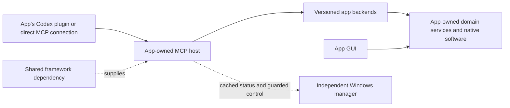

# CodexMCPBroker


Shared MCP application framework and Windows service manager

Build app-owned MCP hosts from one versioned dependency. Each application keeps its own Codex plugin, domain services, native software ownership and authorization. The shared framework standardizes backend discovery, controlled replacement, policy, sessions and durable operation receipts to reduce unnecessary Codex reloads.

**There is no universal Codex plugin.** The former Universal Tools plugin, marketplace and installation/skill-aggregation commands are retired. The independent Windows manager needs no Codex plugin or MCP connection. The Python distribution and import names remain `universal-codex-tools` and `universal_tools` for existing application dependencies. Apps use `universal_tools.framework`. The current packaged checkpoint is **0.20.1**, using **MCP Python SDK 2.3.0**.

The latest packaged checkpoint is **0.20.1**. Development source **0.21.0.dev1** adds an opt-in Windows contained stdio provider. Harmless byte/message fixtures cover its source lifecycle; actual SDK/application integration and a reviewed release wheel remain pending. Existing standalone app testing does not require this optional shared-host migration.

Development source also bounds ledger lock contention, allowing brief competing updates to serialize before admission. Existing packaged applications keep their reviewed dependency pins until a new package is separately verified.

**Status: experimental and under active development. This tool is not mature or production-ready.** The framework is **not currently required** by the MCPServer repositories maintained under [votecoffee](https://github.com/votecoffee). Each app owns installation, migration and native/Codex acceptance. A package upgrade does not fix an app's resource leaks automatically. The durable [resource ownership API](docs/resource-ownership.md) and manager cleanup controls require explicit app adoption; management registration alone is not resource tracking.

The [SDK 2 feature guide](docs/sdk2-features.md) describes opt-in modern connections, ownership-bound approval continuations, catalog notifications, scoped discovery caches, SSE response budgets, tracing and skill resource snapshots. These features do not migrate existing integrations.

The [extension developer guide](docs/extension-development.md) covers durable MCP Tasks with authorized push notifications and form/URL inputs for app-owned jobs, verified downstream Skills, explicit aggregation, live skill publication, host import profiles and extension lifecycle hooks. These optional framework APIs keep app authorization and uncertain outcomes intact. Live MCP skill delivery remains separate from native host skill activation; OpenAI's documented plugin import uses versioned submission-time snapshots.

The [deployment guide](docs/deployment.md) covers opt-in remote HTTPS/OAuth, service and workload-identity grants, DPoP clients, shared notification delivery and durable shared Tasks. The [native Apps example](examples/native_features.py) demonstrates interactive tool resources with meaningful text fallback. Replicated native SDK hosts and retained broker workers have distinct process/state contracts.

The [SDK feature support matrix](docs/sdk-feature-support.md) records implemented profiles, inherited SDK APIs and remaining relay/configuration gaps. Framework 0.20.1 does not claim complete forwarding of every SDK feature. In particular, relayed resource/prompt input rounds and automatic downstream Tasks/UI forwarding remain outside the current profile.

The [beta completion plan](ROADMAP.md) separates the implemented broker foundation from remaining adapter/host acceptance and later native migration pilots. Parallel private contexts and full app/host payload parity are not currently promised.

The [adapter assessment](docs/adapter-assessment.md) covers session ownership, app-owned jobs and production feature workers, including refresh, reload and failure handling. Passing those checks with fake native providers still leaves Codex host and native acceptance to complete for each selected workflow.

Building a new server? Start with the [MCP server developer guide](docs/server-development/README.md), including a read-only quickstart, shared-service architecture, state/recovery contracts, registration/discovery and a reusable acceptance record. The guide distinguishes MCP conformance from this broker's supported integration profile.

The optional [Windows tray manager](docs/service-management.md) displays installed/running/available versions, pending updates and app-reported health. Its default view groups instances by app and explicitly flags multiple responding instances. **Show instances and history** reveals exact processes and stopped/unreachable registrations; historical rows are not running servers. Run **`InstallManager.cmd`** to install it independently of the broker/plugin. Apps opt into `universal_tools.management` for live status and guarded restart controls. Other installed plugins appear as **Not reporting**, with restart disabled.

The manager's **Owned resources** view reads durable private JSON independently of a live service endpoint. It can review and clean up eligible app-declared orphan processes by exact creation identity. The shared `ResourceLedger`/`ResourceOwner` API includes Windows job-contained launching and app-owned recovery attestations. Attached user software, shared leases, unknown identities and unresolved outcomes are protected. See the [resource guide](docs/resource-ownership.md) for limits and adoption requirements.

Apps can select a host-local [session and stdio transport factory](docs/app-framework.md#app-owned-session-and-transport-factories) for every discovery, probe and worker connection. This selection hook preserves task ownership and refuses fallback when the provider fails. The development [owned stdio provider](docs/app-framework.md#contained-stdio-development-profile) adds restricted byte pipes to the Windows launcher; it requires separate SDK/application acceptance before deployment.

## Table of Contents

- [Background](#background)
- [Install](#install)
- [Usage](#usage)
- [Architecture](#architecture)
- [Limitations](#limitations)
- [API](#api)
- [Maintainers](#maintainers)
- [Contributing](#contributing)
- [License](#license)

## Background

Apps own their tools, native processes, data and authorization. The [shared app framework](docs/app-framework.md) standardizes discovery, backend lifecycle, ownership, policy and receipts without requiring the universal broker. Publish a new backend revision and refresh its catalog after quiescing affected state; the native MCP front-door schemas stay fixed. Frequently changing guidance belongs behind app read tools. Native skill/package changes still require Codex reload.

Manage the framework as a versioned package dependency, with tested app-specific pins and lock files. Python wheels are implemented; native .NET/NuGet bindings remain future work. See [package management and lifecycle](docs/app-framework.md#package-management). Source submodules and copied framework implementations are not the default model.

Each app distributes its own Codex plugin and native skills. Backend capabilities and MCP-delivered guidance can update behind that app's stable connection. The framework and manager are shared code and administration facilities, not a replacement universal plugin. Historical broker/coexistence/skill-composition documents describe a retired deployment experiment; their plugin installation commands are no longer shipped.

The app framework can expose fourteen fixed discovery/invocation tools over app-owned backends, or an app can compose native SDK extensions. Retained routing/protocol components also support isolated development fixtures. These internals do not constitute a universal plugin. Connections must not cause unbounded native software copies; the app supervisor owns sharing, resource tracking and cleanup.

## Install

### Dependencies

- Windows and PowerShell. Windows with Python 3.13 is the validated development environment.
- Python 3.11 or newer with the Windows `py` launcher; setup defaults to Python 3.13.
- Git to clone the source. Codex CLI is optional for read-only plugin inventory in the manager.

### Framework development

Follow the [framework guide](docs/app-framework.md) for the `ApplicationHost` API, a harmless publish/reload example, package pinning and app adoption gates. Build/install a verified local wheel or use an editable development dependency; this repository does not imply a published package feed. The framework host has its own runtime requirements, so preserve an existing app's dependencies by using a separate host environment when needed.

### Tray manager

Double-click **`InstallAndRun.cmd`** to install and open the manager dashboard. `InstallManager.cmd` remains a direct tray installer. Add `-NoPause` to skip the closing prompt, `-StartAtLogon` for automatic startup or `-InstallOnly` to install without opening it. The manager title shows its runtime version. A matching verified installation is reused; opening an already running manager brings its dashboard forward. Exit the manager before upgrading, or use `-Reinstall` to rebuild the same version after exiting. Its separate runtime does not replace server environments or reinstall plugins. See [service management](docs/service-management.md) for app integration and isolated installation options.

### Development runtime

From PowerShell:

```powershell
git clone https://github.com/votecoffee/CodexMCPBroker.git
Set-Location CodexMCPBroker
.\scripts\Setup.ps1
```

Setup installs a local framework development environment. It does not install a Codex plugin, initialize registrations or start MCP services. The root `InstallAndRun.cmd` opens only the independent manager; the former `-Broker` option is removed.

Applications install and pin the shared framework in their own environments. No public package feed is implied; build and verify a local wheel. See the [framework package guide](docs/app-framework.md#package-management).

Setup keeps its runtime and private development pointer under ignored `.local/`. The manager uses a separate installed runtime. Neither path installs or enables application plugins.

You can create a manager launcher shortcut without installing or starting anything by running `.\scripts\Create-LauncherShortcut.ps1`. Its generated `.local/InstallAndRun.lnk` stays ignored. Project icons live under `assets/`; the Windows ICO preserves all eight original sizes from 16 to 256 pixels.

Pass `-PythonVersion` to select another installed Python version. Each application owns its framework dependency update, backend acceptance and plugin packaging.

## Usage

### Internal development CLI

Run these commands from the repository root:

```powershell
.\.local\development\Scripts\python.exe -m universal_tools --state .\.local\development-state init
.\scripts\Broker.ps1 start
.\scripts\Broker.ps1 status
.\scripts\Broker.ps1 list
.\scripts\Broker.ps1 refresh
.\scripts\Broker.ps1 stop
```

These are explicit routing-library development commands. They are not installed as a Codex connection by this project. Use isolated fixtures, not normal native app registrations, for routine checks.

### Application skills

Applications keep their own native skill packages and can expose dynamic guidance through MCP using `SkillCatalog` and `SkillRegistry`. MCP publication and native host skill activation are separate. See the [extension guide](docs/extension-development.md).

```powershell
# Publish skills through the application's own host and package.
```

The old Universal Tools skill composer and plugin installer are retired. The framework does not combine app plugins into a universal package.

### Try the example services

```powershell
.\scripts\Broker.ps1 start-demo
.\scripts\Broker.ps1 list
```

The demonstration starts example math and notes services. Default loopback ports are 8768 for the broker, 8769 for math and 8770 for notes; setup can select a different broker port. The demo supervisor stops its example processes when the broker exits.

For an explicitly authorized protocol fixture, use the SDK client directly:

> Refresh the fixture catalog, describe the example math add tool, and calculate 12 + 30.

### Register an app

Copy a descriptor into the ignored local directory, then edit its app ID, endpoint and policy:

```powershell
Copy-Item .\examples\app-http.service.json .\.local\my-app.service.json
notepad .\.local\my-app.service.json
.\scripts\Register-App.ps1 -Manifest .\.local\my-app.service.json
.\scripts\Broker.ps1 refresh
```

Use [app-http.service.json](examples/app-http.service.json) for an MCP Streamable HTTP endpoint on literal loopback. Use [app-stdio.service.json](examples/app-stdio.service.json) for a stateless stdio adapter. Existing REST endpoints need an MCP adapter.

For an integration that needs state across calls, review [app-exclusive.service.json](examples/app-exclusive.service.json) and the ownership contract before registration. Persistence is opt-in; existing registrations keep their transient lifecycle.

Registration is a local administrative action: it authorizes connecting to the endpoint or launching the configured executable. The broker scans its registration directory; app installers can use the same registration command. It does not automatically discover arbitrary installed applications.

See the [app integration contract](APP_CONTRACT.md) and [registration schema](examples/service.schema.json) for authentication, lifecycle, ownership and validation requirements.

Failed discovery includes a redacted `failure` object in `refresh_services` and `list_services`. Its `phase` distinguishes connection/initialization, tool listing, catalog reads and normal session cleanup; `kind: "timeout"` identifies a reported timeout and includes the configured budget. The phase is the last observed stage, not a root-cause diagnosis. Inspect the app and host resource conditions before another explicit attempt. Discovery does not retry automatically, and recovery barriers remain in force.

### Invoke tools

Search for a tool, use `describe_service` for its app's initialization guidance and capabilities, then `describe_tool` for its schema and `catalog_revision`. Invoke it with that revision and schema-valid arguments. Writes also require a unique `request_id`. The broker checks the live definition before dispatch; changed registrations or definitions require another refresh/describe cycle.

`describe_service` returns the app's negotiated protocol version, server information, advertised capabilities and optional instructions, alongside the broker's actual relay support. This is attributed, untrusted app data. It cannot authorize unrelated actions or change broker policy. The catalog snapshot comes from discovery; after acquiring an exclusive context, describe the service again to inspect that session's guidance. Only its active owner receives the session snapshot. Other frontends receive the earlier catalog snapshot, which refresh preserves while the context is owned. Description does not connect to the app or renew a lease.

Registrations default to `allow_writes: false`. Tools need `readOnlyHint: true` for the read channel, except exact legacy tool names reviewed under `read_only_tools`. An explicit false annotation always uses the write channel. App-specific permissions and review requirements remain authoritative.

`describe_tool.invocation` explains the required broker `channel`, whether `request_id_required` is true, the `classification_reason`, and any `registration_blocker`. A tool named "read" can require the write channel when the app creates local exports or other artifacts. These fields explain the registration policy; context ownership, current definitions, app authorization and review checks still apply at invocation. See the [invocation guidance contract](APP_CONTRACT.md#invocation-guidance) for the reason values.

### Discover inner capabilities

Broker 0.8 adds an optional [versioned catalog provider](docs/capability-catalog.md). A registration names a read-only metadata tool that returns a normalized catalog. For unowned services, `refresh_services` queries it and indexes capability IDs, descriptions and tags. Existing apps are unchanged unless explicitly registered with a compatible provider; a tool named `list_capabilities` is not automatically assumed compatible.

`search_tools` distinguishes `kind: "tool"` from `kind: "capability"`; use its `kind` argument to filter either or search `"all"`. Capability results are discovery-only, with `callable: false`. Pass their `capability_revision` to `describe_capability`, inspect the referenced native discovery tool with `describe_tool`, then use the read channel to retrieve the app's current inner schema and workflow. Native calls still use outer tool IDs and their broker revisions; app catalog and target/review revisions remain independent.

After acquiring an exclusive service, call `refresh_capabilities(service_id, context_id)` to index its owned session. Only that frontend sees its catalog; other frontends keep the earlier public snapshot. Global refresh does not probe or publish the owner's catalog. Capability description is observational; a successful owned provider probe renews the lease. Invalid catalogs lose their hints, and transport failures keep normal recovery barriers. Refresh never reloads app extensions or distributes app skills.

### Scope pilot access and payloads

Broker 0.7 adds optional local registration fields for selected writes and larger arguments. For a disposable pilot, review the actual app tool names and payload requirements before setting, for example:

```json
{
  "allow_writes": true,
  "allowed_write_tools": ["prepare_change", "apply_change"],
  "max_argument_bytes": 2097152
}
```

This is a descriptor fragment, not a registration command. `allowed_write_tools` contains exact, case-sensitive outer MCP tool names without the service prefix. It applies only when `allow_writes` is true. An empty list disables all writes; omission or `null` preserves the existing service-wide write flag. A newly advertised write-capable tool stays blocked unless named in a configured list. This does not change read/write classification or filter operations inside an extension wrapper; apps must enforce their inner operation policy.

`max_argument_bytes` defaults to 262,144 and accepts 1–67,108,864 bytes (64 MiB). It measures the entire argument object encoded as compact UTF-8 JSON, including base64 and JSON escaping. The broker HTTP envelope has an independent 10 MiB default limit. `describe_tool` reports the argument limit; `describe_service` reports policy and actual limits. A larger registration budget does not enlarge the app's or host's limits. The broker forwards one app invocation without splitting, truncating or replaying it.

For an assessed bulk workflow, finish active work and stop the broker before changing its HTTP body limit. This local administrative command accepts 1–134,217,728 bytes (128 MiB), preserves other settings and refuses a running broker or concurrent startup:

```powershell
.\scripts\Broker.ps1 configure-request-limit -Bytes 134217728
```

Then start the broker and explicitly set `max_argument_bytes` in only the reviewed service registration, up to 67,108,864. Both opt-ins may be needed: a service budget does not override the HTTP envelope, and a larger HTTP allowance does not override a smaller service budget. HTTP whitespace and ASCII-escaped Unicode can make the incoming body larger than the compact UTF-8 argument measurement. Existing settings keep the 10 MiB HTTP default; setup preserves an explicitly configured limit. Messages remain whole in-memory JSON requests, so larger limits increase memory and processing costs. Use app-owned file routes when appropriate; do not split reviewed batches to bypass a limit.

Changing either setting changes catalog revisions and can retire a retained session. Finish/reconcile its work before local reconfiguration. See the [migration assessment guide](MIGRATION.md) for scoped compatibility checks while retaining direct integrations.

### Select a session mode

Mode selection is an administrative registration decision. Existing registrations keep their default lifecycle.

| `session_mode` | Downstream lifecycle | Access across chats |
| --- | --- | --- |
| `transient` (default) | New session/process for each discovery or call. | Any frontend; the app retains shared business state. |
| `exclusive` | One retained session leased to a frontend with a context handle. | Only its owner can call or release it. |
| `shared` | One retained, broker-owned adapter, opened lazily on a call or explicit capability probe. | All frontends use the same adapter without context handles. |

Shared mode removes repeated adapter startup for an independently running app service. It requires an app-owner review: targets, jobs, review tokens and authorization must be explicit and safe to share. Process-local current selections, private review plans or per-chat credentials are incompatible with this mode. The broker does not forward a chat identity to the app or supply per-job privacy. See [app-shared.service.json](examples/app-shared.service.json) and the [shared session contract](APP_CONTRACT.md#retained-shared-adapters).

Use the [adapter session assessment](docs/adapter-assessment.md) to trace captured reads, pending plans, jobs and shutdown effects before choosing a mode. A plan ID or durable job record does not establish that its live state survives a fresh adapter. The worksheet includes fake-backed approval, ownership and lost-reply checks; host and native acceptance remain separate gates.

Shared calls remain serialized and recheck tool definitions and registration policy. Successful calls renew the idle deadline. Clean idle expiry, reconfiguration and shutdown close the adapter; a later explicit call can open a new one. A timeout, cancellation, transport failure or crash keeps a durable recovery barrier for every frontend. There is no automatic reconnect or replay after loss. `service_session_status` reports shared health without returning a context handle; acquire/release tools apply only to exclusive mode. Forms and progress return only to the initiating call. Capability hints remain shared catalog data, and service descriptions retain the installation-level initialization snapshot.

### Own a stateful workflow

For a service registered with `session_mode: "exclusive"`, call `acquire_service` and retain its `context_id`. Include that handle in every read/write call. The broker keeps one downstream session/process alive for that frontend across calls and catalog refresh. A competing frontend cannot acquire, call or release the context, even if it knows the handle.

Calling `acquire_service` again from the same frontend renews its active lease. App calls renew it after success. `service_session_status` inspects ownership/health without renewing it. Save or reconcile app state before `release_service`: release, idle expiry, registration changes and broker shutdown close the downstream connection and can discard process-owned documents or review plans.

An app's independent service can retain background jobs after adapter release. Keep its job IDs and poll for actual outcomes; a completed broker start receipt only acknowledges the returned handle. Cancellation requests and native completion remain app-owned. New contexts may see existing shared jobs according to app policy. See the [background job contract](APP_CONTRACT.md#app-owned-background-jobs).

The default idle lease is 900 seconds, configurable from 5 to 86,400 seconds. In-flight operations retain their lock until completion or bounded cleanup. A timeout, transport failure or abandoned in-flight call leaves the context lost; it is not automatically recreated. Durable reservations keep lost contexts blocked across restart and beyond their previous idle deadline. Restart does not restore native state or prove earlier work stopped.

Every successful call renews the live lease. Frequent renewals coalesce only the journal's expiry timestamp snapshots, for up to five seconds or one quarter of the lease. Reservation checks and durable state transitions remain immediate. The saved timestamp cannot release a lost reservation; see the [ownership contract](APP_CONTRACT.md#identity-and-scope).

### Recover a lost context

Inspect `service_session_status` or the local `contexts` command. A service reporting `recovery_required` is blocked for all frontends, including transient or renamed registrations that address the same recorded resource. Neither release nor catalog refresh clears this condition.

Stop the broker, inspect/reconcile the app's actual state, and use the local administrative recovery command. Replace `APP_ID` and `CONTEXT_ID` with values from `contexts`:

```powershell
.\scripts\Broker.ps1 stop
.\scripts\Broker.ps1 contexts
.\.local\runtime\Scripts\python.exe -m universal_tools --state .\.local recover-context APP_ID --context-id CONTEXT_ID --acknowledge-outcome
.\scripts\Broker.ps1 start
```

Only acknowledge after reconciliation. Recovery records that acknowledgement and clears the reservation; it performs no native cancellation, rollback, save or reattach. It is unavailable as an MCP tool and refuses to run while a broker owns that state directory. A stale or incorrect handle cannot clear a newer context.

## Architecture



Applications own their plugin, supervisor and software resources. The shared dependency standardizes framework code; the manager is an independent administrative application. No universal plugin is installed. The [resource lifecycle contract](docs/server-development/sessions-and-recovery.md#track-owned-software-and-subprocesses) distinguishes owned launches, user-owned attachments and deliberately shared resources.

### Internal routing and receipts

The framework's routing engine serializes connection, validation and invocation per service ID. Exclusive mode adds a workflow lease bound to a frontend instance. A dedicated worker task owns the downstream SDK transport through initialization, calls and teardown. These are app-host internals, not a universal plugin deployment.

Each stdio frontend lazily reuses up to four initialized broker HTTP sessions. Sequential requests normally reuse one channel; concurrent requests borrow independent channels and queue when all four are occupied. Every channel carries that frontend's same identity. Failed calls are returned without automatic replay. A later explicit request can create a replacement connection. Frontend shutdown drains dispatched work and closes its connections; app contexts retain their existing lease and recovery rules.

App form elicitation can travel through those channels to the client that initiated the tool call. The broker identifies the app/tool in the prompt, validates accepted form data and preserves decline/cancel responses. Unsupported clients and failed or expired confirmations receive errors; the broker never generates approval or caches an earlier answer. The originating client controls the user interface. App approval policy still applies, and native host acceptance remains a separate check.

Broker 0.9 also relays [request-bound progress](APP_CONTRACT.md#request-bound-progress) when the calling client supplies an MCP progress token. Tokens are mapped separately at each hop; updates return only to their originating request. App messages are attributed to the service/tool. Progress is best-effort telemetry: bursts are coalesced, delivery is bounded, and slow receivers lose updates without changing the app result. It does not extend deadlines, prove completion, authorize an action or cancel native work. Host display needs separate acceptance.

This is frontend affinity within one authenticated broker, not an authenticated Codex chat principal or a native project lease. A restarted frontend has a new identity and cannot adopt the old lease. Apps still own resource IDs, locks and revision checks across direct clients, other brokers and GUI edits. Closing a proxy does not reset independently running app state; a new owner must still select/inspect its intended resource explicitly.

Write claims are stored in SQLite before dispatch. Reusing a claimed ID never dispatches the write again, including after restart. The journal stores status and fingerprints, not arguments or results. Inspect `get_request_status` after a lost response and reconcile actual app state after uncertain outcomes. Duplicate-dispatch prevention does not establish exactly-once execution or native rollback.

## Limitations

- The default reference broker serves one local user account on literal loopback HTTP. Remote registrations require explicit HTTPS opt-in and their own authentication. Optional app-host OAuth deployments enforce issuer, resource, scopes and verified user identity; see the deployment guide. Keep local settings and credentials private. Incoming broker credentials are never copied to apps.
- Transient mode opens a fresh downstream session/process for each discovery or call. Exclusive mode retains one session for its owner; shared mode retains one broker-owned adapter accessible to all frontends. Discovery without a retained worker still uses temporary sessions. Shared mode requires app-owned state and explicit targets; it cannot isolate private per-chat state inside that adapter. App-owned HTTP engines must retain business state independently of individual HTTP requests.
- Identical routes and declared resource aliases involving any retained session are rejected. Use a stable `resource_id` for different routes to one native resource. The broker cannot infer arbitrary app aliases or fence direct/manual clients. Native sessions and live lease timers remain in memory; durable reservations preserve the recovery barrier, not the native process or its state.
- The packaged stdio frontend pools legacy broker HTTP sessions, but every routed call still sends broker requests and rechecks downstream tool definitions. This path uses stateful Streamable HTTP/SSE, with 256 HTTP sessions and a 900-second idle limit. Session IDs are bound to their initiating frontend identity. A restart or expired session is reported as failure without replay; app leases remain independent. Frontend connection initialization has a 20-second deadline; each dispatched broker operation has a 330-second deadline, excluding pool queue wait. Opt-in modern native connections use stateless per-request metadata and require trusted frontend identity for private ownership; see the [SDK feature guide](docs/sdk2-features.md).
- Tool routing, request-bound form/URL elicitation and opt-in progress are supported. Optional framework extensions add app-owned MCP Tasks with push notifications, verified Skills, and explicitly selected resource/prompt/completion federation. SDK Apps can be composed directly. The generic broker does not automatically relay arbitrary downstream Tasks, sampling, roots or UI tool calls; these require app-owned integration contracts. `describe_service` exposes initialization metadata and explicit `elicitation_form`/`elicitation_url`/`progress` support flags; advertised app capabilities do not enable other relays. App skills are not automatically installed or activated.
- Form relay accepts flat primitive fields and enum arrays, with no schema references. Budgets are 32 KiB per request, 16 KiB per response, one outstanding form and eight forms per tool call. Each form has a 60-second relay deadline, while the app's shorter operation deadline continues running. A late answer cannot revive an expired call. Background/session-wide and task-augmented elicitation are unsupported.
- Inner capability search requires an opt-in normalized provider; arbitrary app catalogs are not parsed automatically. Catalog hints are bounded to 512 KiB and 1,000 entries, are not executable routes, and do not replace app-specific discovery or approval. Broker refresh does not reload app extensions or distribute app skills.
- Budgets include 128 KiB initialization metadata, 128 KiB schemas and argument objects defaulting to 256 KiB with an explicit per-service maximum of 64 MiB. Incoming broker requests default to 10 MiB, with an independent stopped-broker configuration ceiling of 128 MiB. Oversized initialization metadata is rejected without truncating instructions. App and host limits remain independent. App timeouts default to 20 seconds and allow 0.2–300 seconds; queue wait happens before that deadline. Client disconnect or timeout can leave queued or running work whose outcome needs inspection.
- Removed or invalid registrations lose routes on refresh. Revocation is also checked before a new call; already-dispatched work can continue. Unknown effects use the write channel, and service write policy applies to that whole category.
- Protocol and example-service checks do not establish compatibility or native acceptance for a particular engineering application. Validate each app's state continuity, policy, media/results and failure behavior before integration.

## API

| MCP tool | Purpose |
| --- | --- |
| `broker_status` | Inspect broker availability and catalog state. |
| `list_services` | List registered app services and their discovery status. |
| `refresh_services` | Reload registrations and query app tool definitions. |
| `search_tools` | Search outer tools and opt-in inner capabilities, with an app/kind filter. |
| `describe_service` | Inspect attributed app initialization guidance, capabilities and broker relay support. |
| `describe_tool` | Retrieve a tool definition, policy and catalog revision. |
| `describe_capability` | Inspect a searched inner capability and its read-only native discovery reference. |
| `refresh_capabilities` | Query an opted-in provider; exclusive catalogs require the owner's active context. |
| `call_read_tool` | Invoke an allowed read operation with the described revision. |
| `call_write_tool` | Invoke an enabled write operation with a unique request ID. |
| `get_request_status` | Inspect a persisted write claim after a lost response. |
| `acquire_service` | Acquire or renew this frontend's exclusive service context. |
| `release_service` | Release the owned context and close its downstream session/process. |
| `service_session_status` | Inspect ownership, health and remaining idle lease without renewal. |

The CLI entry point is `universal-tools`, also available as `python -m universal_tools`. For example:

```powershell
.\.local\runtime\Scripts\python.exe -m universal_tools --help
.\.local\runtime\Scripts\python.exe -m universal_tools --state .\.local status
```

See [the framework guide](docs/app-framework.md) for the app-facing API, [APP_CONTRACT.md](APP_CONTRACT.md) for internal downstream routing contracts, and [VERIFICATION.md](VERIFICATION.md) for reproducible development/package checks. Historical universal-plugin migration and composition documents are not current deployment instructions.

## Maintainers

[@votecoffee](https://github.com/votecoffee)

## Contributing

Questions and bug reports belong in [GitHub issues](https://github.com/votecoffee/CodexMCPBroker/issues). Pull requests are welcome. Follow [CONTRIBUTING.md](CONTRIBUTING.md) for development checks, public documentation rules and release packaging.

An optional [cross-SDK profile](VERIFICATION.md#cross-sdk-profile) checks the MCP 2.3 framework/broker against a synthetic MCP 2.3 server in a separate environment, with an additional MCP 2.2 backend compatibility fixture. It compares the negotiated `2025-11-25` path, full results, media, ownership and uncertain writes. The runtime now uses SDK 2.3; this profile does not establish native app compatibility or support for newer protocol features.

## License

[MIT](LICENSE) © 2026 votecoffee.
