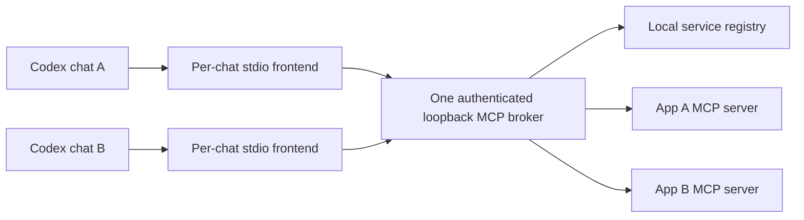

# CodexMCPBroker

[GitHub repository](https://github.com/votecoffee/CodexMCPBroker). The local Codex plugin is named **Universal Tools**, version 0.1.1. Its Python package and CLI retain the existing `universal-codex-tools` / `universal-tools` names.

One reusable local Codex plugin connects multiple chats to a shared MCP broker. Each app owns its own MCP server. Apps install a small service registration; refreshing the broker makes their tools discoverable without changing the plugin.



The plugin has eight fixed tools: `broker_status`, `list_services`, `refresh_services`, `search_tools`, `describe_tool`, `call_read_tool`, `call_write_tool`, and `get_request_status`. New app tools are catalog entries behind that surface. They do not become individual native Codex tool definitions in this version.

## Run on Windows

Tested with Python 3.13 on Windows. The package requires Python 3.11 or newer; other versions/platforms have not been validated here. No OpenAI API key is used.

From this source directory:

```powershell
.\scripts\Setup.ps1
.\scripts\Broker.ps1 start-demo
.\scripts\Broker.ps1 list
.\scripts\Install-Plugin.ps1
```

Setup creates a virtual environment and private broker state under `.local`, then configures the plugin's secretless runtime pointer. `Install-Plugin.ps1` adds this local marketplace and installs only Universal Tools. Start a new Codex chat after installation. Each new frontend starts the broker if necessary and connects to the same state directory. Closing a chat leaves the shared broker running for other chats.

The example stack uses loopback ports 8768 (broker), 8769 (math), and 8770 (notes), unless setup selects another broker port. Its supervisor stops the example app processes when the broker exits. Start-demo is an explicit demonstration command; normal startup does not launch app HTTP servers. Use:

```powershell
.\scripts\Broker.ps1 status
.\scripts\Broker.ps1 refresh
.\scripts\Broker.ps1 stop
```

After changing broker code, stop it and run Setup again. After changing the plugin package itself, reinstall it so Codex refreshes its cached copy. Registering another app does not require reinstalling the plugin.

## Add an app

Have the app expose an MCP Streamable HTTP endpoint on literal loopback, then copy and edit `examples/app-http.service.json`. Register it with:

```powershell
.\scripts\Register-App.ps1 -Manifest C:\Path\To\my-app.service.json
.\scripts\Broker.ps1 refresh
```

An app installer can run the same registration command as the current user. Local registration is the trust boundary: it authorizes connecting to the configured app and, for stdio, executing its installed command. No broker tool accepts arbitrary registration files, command lines, or URLs. Discovery scans only the configured `services` directory; arbitrary Windows applications are not automatically exposed.

HTTP is preferred for a shared app server. `examples/app-stdio.service.json` provides compatibility with existing stdio integrations. In this first version, stdio launches a new process per discovery/call session, with calls serialized by registration. Apps needing persistent in-memory state should use their own long-running HTTP server. Broker startup does not install dependencies or download executable code.

Each service receives a namespace, such as `my-app/open_document`. Names may overlap across different apps. Registrations default to `allow_writes: false`. A tool must explicitly advertise `readOnlyHint: true` to use the read channel. For a legacy server, the owner can review and list exact read tool names under `read_only_tools`; an explicit false annotation still wins. Unknown operations use the write channel and remain blocked until that service's writes are enabled.

Read `APP_CONTRACT.md` for the registration schema, authentication, app lifecycle, and ownership rules.

## Example conversation

Ask a new chat:

> Use Universal Tools. Refresh services, find the example math add operation, describe it, and calculate 12 + 30 through it.

For an isolated example write:

> Use Universal Tools to read notebook demo from example-notes. Then append "first shared broker test" using its current revision and a unique write request ID.

An invocation first describes a tool, then supplies the returned `catalog_revision`, exact schema arguments, and, for writes, a unique `request_id`. The broker checks the current app definition again before dispatch. Changes to registrations or tool definitions require another refresh/describe cycle.

## Multiple chats and write outcomes

The broker accepts concurrent clients and runs independent apps concurrently. It serializes the full connection/validation/call sequence per service ID. Apps remain responsible for their own resource locks and revision checks, including requests arriving through other MCP clients or multiple service aliases. No automatic chat ID is assumed or used as authorization.

Write claims are persisted in SQLite before dispatch. Reusing a request ID never dispatches that write again, including after broker restart. Results and arguments are not retained in the journal. Inspect `get_request_status` after a lost response. `uncertain` or interrupted `in_progress` means the actual app state needs inspection; `app_error` can also follow partial changes. This is duplicate-dispatch prevention, not a distributed exactly-once guarantee. Completed results are not replayed from storage.

The app still owns preview/apply sequences, explicit target IDs, authorization, revision conflicts, and native save/compile behavior. The broker does not confer runtime or engineering acceptance.

## Scope of this first version

- Loopback on one Windows user account; a random bearer token protects the broker. Browser-origin requests are rejected. `.local/settings.json` contains a credential and must remain private.
- HTTP app credentials can be read from a named environment variable. The broker's own credential is never forwarded to an app. Stdio forwards only specifically configured additions to the SDK's minimal platform environment.
- SDK tool text, structured content, images, and `isError` results are preserved. The interface supports tools only: downstream resources, prompts, OAuth linking, sampling, elicitation, progress notifications, and app UI resource routing are not implemented.
- Catalog refresh is explicit. Unavailable, disabled, removed, or invalid registrations lose their routes on refresh; local removal/revocation is also checked immediately before a new call. Already-dispatched calls cannot be revoked retroactively.
- Calls are bounded by an app timeout after acquiring its broker lock. A large queue can exceed a client's timeout before dispatch; use unique write IDs and check state before retrying.
- App manifests/tool descriptions are trusted only for capability discovery, never as permission to override the user's instructions. Delegated invocation tools conservatively declare open-world access; individual app annotations remain visible in descriptions.
- This package was tested through official MCP SDK clients and its plugin launcher. Native Codex model selection of these tools in a new chat is a separate acceptance check.

## Development and evidence

```powershell
py -3.13 -m venv .venv
.\.venv\Scripts\python.exe -m pip install -e '.[dev]'
.\.venv\Scripts\python.exe -m pytest -q
.\.venv\Scripts\python.exe -m ruff check .
.\.venv\Scripts\python.exe -m ruff format --check .
```

`requirements-lock.txt` records the tested runtime dependency versions; `requirements-dev-lock.txt` records the test environment. Setup installs the runtime lock before installing the source package. `scripts/package_release.py` builds `dist/CodexMCPBroker-0.1.1.zip`, file hashes, and a verifier while excluding Git metadata, credentials, local databases, cached code, and virtual environments. Use `--output-dir PATH` to put the deliverable elsewhere.

Architecture follows [OpenAI plugin packaging](https://developers.openai.com/plugins/build/plugins) and [MCP server guidance](https://developers.openai.com/plugins/build/mcp-server). The broker, registry, and app contract are this project's implementation choices.
