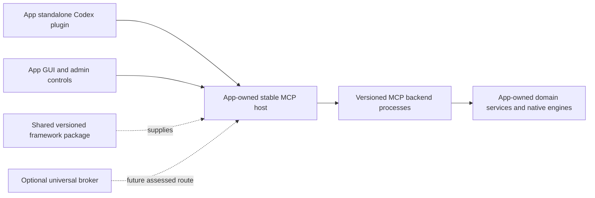

# Shared app framework

The primary development direction is a reusable app-owned MCP framework that reduces Codex reloads and standardizes backend code. The universal broker remains an optional aggregation experiment. Apps can use the framework with their own standalone Codex plugin and no Universal Tools installation.

The current framework is 0.17.0, using MCP Python SDK 2.3.0 with a separate SDK 2.2 compatibility profile. It provides the Python `universal_tools.framework` API and an authenticated loopback reference host, plus optional Tasks, Skills, native protocol federation, Apps and OAuth/shared deployment profiles. See the [SDK support matrix](sdk-feature-support.md), [extension guide](extension-development.md) and [deployment guide](deployment.md). The framework remains experimental. Each app owns its adoption; real Codex activation, native behavior, performance and full standalone/aggregated parity require app-specific acceptance.

## Stable front door, replaceable backends



The app host exposes the existing fourteen discovery/invocation tools. Backend tools are searched, described and invoked through that stable schema. Publishing a new backend tool updates the runtime catalog without changing the native MCP front-door definitions. Keep the app's packaged skill entrypoint small and stable; put frequently changing feature descriptions and [workflow guides](workflow-contributions.md) behind the app's read tools. Updates to native `SKILL.md` files still require package installation and Codex reload.

The framework reuses the existing policy, schema validation, argument limits, SDK session actors, exclusive/shared ownership, receipts, forms and progress implementations. It does not duplicate native features or move app authorization into metadata. App code and native dependencies remain behind MCP worker processes, not Python module imports into the host.

| Change | Required lifecycle |
| --- | --- |
| Live feature/workflow metadata behind unchanged schemas | Refresh the app's current catalog; no native plugin update. |
| New tool or code in a backend publication | Quiesce/release the affected backend, publish a new revision and refresh; the MCP front door stays connected. |
| Shared retained adapter replacement | App admin verifies quiescence and explicitly retires the healthy adapter before refresh. |
| Framework runtime, app identity or startup instructions | Update the app dependency and/or restart its host; reconnection and lost-context recovery need acceptance. |
| Native skills or front-door MCP schemas | Update the app plugin and reload Codex. |

Protocol tests keep the same native MCP client sessions connected across a backend change and compare all frontend definitions. That demonstrates the wire behavior, not a completed Codex desktop reload/activation test.

## Package management

The current Python distribution remains **`universal-codex-tools`**, preserving its existing name, while apps import the framework API. Distribute verified wheels and use each app's normal dependency management. Pin the exact tested framework version while the API is experimental, and keep transitive dependencies locked in that app's build. The repository builds a wheel; no public package-feed publication is implied. Install a verified local wheel or use an explicit local development dependency until a feed release is available.

Python apps can use editable installs during coordinated development and versioned wheels for builds/releases. Keep dependency installation out of live tool calls. The current package pins MCP Python SDK 2.3.0 and its runtime dependencies; embed it only in a compatible environment. SDK 2.2 backend compatibility tests do not change that package pin. An app with conflicting SDK/native requirements can run the host in a separate environment and expose its backend using the supported MCP contract. Do not silently downgrade an existing app's SDK.

Native .NET bindings can be distributed through NuGet with `PackageReference` when implemented. They are not shipped in this checkpoint. Keep lifecycle/publication contracts versioned across languages, while native engine adapters remain language-specific. An out-of-process MCP backend can already be implemented in another language; that is distinct from an in-process .NET framework library.

Use package versions, release hashes, compatibility tests and app-controlled upgrades. Source submodules are not the default dependency model. Do not copy framework implementation files into each app or make each app track the repository's current branch. Framework/runtime, backend publication and native skill package versions have separate lifecycles. Publishing packages or pushing repository changes remains a separate release action.

## API and reference host

The [application schema](../examples/application.schema.json) is generated from `ApplicationDefinition`. An app-owned JSON publication declares stable application identity/instructions plus up to 32 `BackendPublication` entries. Each entry has an explicit revision, a normal `ServiceManifest`, and a pinned entrypoint artifact for stdio. HTTP backends keep deployment/restart responsibility in the app; the framework reconnects to the published endpoint and does not reload that remote server's code.

```python
from universal_tools.framework import ApplicationHost

async with ApplicationHost(private_state, app_publication) as host:
    client = host.client()  # one affinity identity per app frontend
    result = await client.invoke("search_tools", {"query": "inspect"})
```

`create_server()` supplies the fixed MCP surface for an app-owned host; it needs the host lifecycle and the app's authenticated serving arrangement. `app-serve` provides the included loopback reference implementation using the existing bearer/origin guards and private settings. Give each app a dedicated state directory. Framework state must not reuse an existing universal broker's service registrations.

Try the harmless reference without installing a plugin or touching a native app:

```powershell
# Use the development interpreter/environment described in VERIFICATION.md.
python examples/framework_app.py --state .local/framework-example --generation 1 --port 8890
python -m universal_tools --state .local/framework-example app-serve --publication .local/framework-example/example-application.json
```

In a second terminal, publish generation 2 with the same state and port. Through the still-connected app MCP client, release any owned context after completing its work, then call `refresh_services`. `text-engine/count_words` becomes searchable while the fourteen frontend definitions stay unchanged. The example only inspects supplied text and starts disposable Python workers. Keep its bearer token/private runtime settings outside public files.

## Publication and reload guards

The app updater owns the publication file and immutable backend deployment directories. Editing that file is an explicit local trust/configuration action; no model tool accepts executable paths or installs modules. A revision change is required when a selected backend definition changes. Stdio publications bind an absolute executable or entrypoint argument to SHA-256. Entry bytes are checked before publication, metadata probing and dispatch. This is an entrypoint integrity guard, not authentication or proof of the complete dependency/resource closure. Apps must preserve and validate their full deployment artifacts separately. Hashing cost scales with entrypoint size; native latency parity is not established.

Keep backend IDs stable and assign a stable service `resource_id` for a native resource that can be reached through changed worker commands, endpoints or aliases. The host cannot infer that two different registrations reach the same document/controller. App-owned target checks and resource fencing remain required; renaming a backend is not outcome reconciliation or permission to reuse another frontend's target.

`refresh_services` drains dispatch through gates for changed backends, leaving unrelated backend calls independently callable. Retained contexts defer publication; refresh does not seize another frontend's state. Exclusive owners must finish/save and release normally. A local app-admin `retire_shared_backend(service_id, expected_revision=..., app_quiescent=True)` can close a healthy shared adapter after app-owned job/state checks. It is not a model-facing MCP tool, native cancellation or a way to clear a recovery barrier.

Interrupted, uncertain and app-error write receipts block replacement until app-owned reconciliation. The local `acknowledge_reload_outcome(request_id, expected_updated_at=...)` API records that explicit app-admin decision against the current receipt. It does not inspect native state, change the original receipt, permit retry of the request ID or clear lost ownership. Apps must authorize and verify reconciliation before invoking it. No metadata probe performs that verification automatically.

Publication uses immutable generated registration snapshots under `<state>/framework/releases/` and one atomic `active.json` pointer. Candidate discovery failure restores the previous configuration; it does not roll back native operations. Cancellation/failed commit removes affected catalog routes until another refresh rather than allowing a staged candidate to dispatch. An uncommitted generation is never selected after restart. Initial malformed publications and changed artifacts fail closed. Metadata construction/teardown must satisfy the app's assessed side-effect boundary.

Native MCP clients receive independent session affinity without accepting owner IDs as tool arguments. In-process clients get separate generated identities. The bearer credential remains a local-user authentication boundary; affinity is not separate-user authentication. Durable lost-context barriers survive host restart. The existing stopped-runtime recovery procedure applies to this dedicated state after app-owned reconciliation.

A native MCP session is not itself evidence of Codex chat isolation. Where the host shares connections, use separate frontend instances and the existing `RemoteBackend`/`create_surface` stdio adapter around the app-owned host; that adapter does not require a universal daemon. Validate actual multi-chat frontend lifetimes and ownership before adoption. Keep app startup app-owned rather than using the optional broker's automatic-start command for framework state.

## Adoption and limits

Run `tests/test_framework.py`, then the relevant [acceptance stages](server-development/acceptance.md) for an actual app. Preserve original handlers, compare complete results, verify two-client state and failure behavior, and measure direct/host latency. The shared engine still serializes calls to one backend. Long-running native work should use app-owned jobs and explicit targets. Native project/controller access and real migrations are not part of the synthetic framework profile.

This checkpoint does not provide native .NET packages, automatic app migration, a public package feed, complete dependency-closure verification or arbitrary in-process DLL/Python hot reload. Ordinary form/URL elicitation is supported through routed tools. Explicit extensions provide app-owned Tasks, Skills and native resource/prompt/completion federation; generic routing still excludes sampling, roots, automatic downstream Tasks/UI tools and arbitrary notifications. Relayed resources/prompts cannot yet conduct input rounds. See the [support matrix](sdk-feature-support.md) for these boundaries. Optional universal aggregation of a framework-based app needs its own discovery, nested policy, guidance and host assessment; an app using the SDK does not automatically certify that route.

## MCP SDK 2.3 upgrade

Framework 0.17.0 requires `mcp==2.3.0`. Supported app interoperability targets SDK 2.2 and later; SDK 1.x compatibility is not maintained. The explicit matrix currently verifies SDK 2.2.0 and 2.3.0; later SDK releases still require validation. Update the framework package and its dependency lock together in a stopped, app-owned environment. Do not replace a live backend environment or downgrade an app SDK to adopt the framework. Existing app publication and registration schema versions remain unchanged.

SDK version and wire-protocol revision are separate. By default, downstream sessions explicitly perform the legacy handshake and use the negotiated `2025-11-25` contract. That remains the default integration profile. Opt-in modern discovery, scoped caching, catalog notifications and owner-bound input rounds use the `auto` or `2026-07-28` profile; see the [SDK 2 feature guide](sdk2-features.md) for configuration and limits. Actual host and app acceptance remains separate.

SDK 2 provides a request-scoped `ServerSession` proxy. For standalone native clients, ownership follows the retained legacy connection, rather than the short-lived proxy or caller-supplied client metadata. The pinned adapter captures this connection explicitly for each tool call. Stateless modern clients without an authenticated frontend identity cannot acquire implicit ownership. App-owned authenticated frontend affinity remains a separate boundary from local-user authentication.

The form adapter captures its route before the SDK dispatcher schedules a callback, preserving rejection of delayed forms from an earlier operation. It advertises ordinary form and URL support, rejects nested task inputs, and retains cancellation/deadline behavior. URL acceptance acknowledges navigation; app authentication/completion is verified separately. If an app propagates the exact RPC refusal generated by that call's relay, it becomes an ordinary error result with the refusal code in `_meta`. Unrelated RPC errors and transport timeouts retain failure/recovery semantics; no approval answer is synthesized. This uses a small pinned dispatcher integration; SDK changes to this seam require the queued-form and protocol profiles again.

Use SDK 2 snake_case Python attributes and `model_dump(by_alias=True, mode="json")` for MCP wire documents. Custom extension data belongs in `_meta`, not unknown top-level SDK model fields: SDK 2 ignores unrecognized fields. The framework disables the new SDK HTTP client's default one-MiB SSE event ceiling to preserve existing large-result behavior; argument and inbound HTTP limits remain independent. This includes app result/media metadata. A framework refresh is not a native application or Codex UI acceptance test.

## SDK 2 runtime features

See [SDK 2 features](sdk2-features.md) for modern ownership, continuations, notification-driven discovery, bounded response transport, diagnostics and opt-in skill resource snapshots. These additions leave native application migrations under app control.

Optional [extension APIs](extension-development.md) provide durable app-owned Tasks with polling/push and form/URL inputs, verified downstream Skills, live skill publication and explicit native protocol federation. `create_server(extensions=[...], skills=catalog)` composes explicitly selected local extensions; extension lifecycle hooks and live resource publication do not hot-load arbitrary code. The app remains responsible for authorization, job reconciliation and host acceptance.


The optional [deployment profiles](deployment.md) add remote OAuth, service grants and shared native SDK hosting. Pass `deployment=` to `create_server()` for an authenticated single-owner app host. Replicated deployments use native `ExtensionServer` APIs with shared persistence rather than separate retained broker engines.
