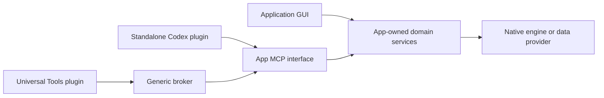

# Application architecture

[Developer guide](README.md) · [Next: tool design](tools-and-workflows.md)

## Own the business service

Put domain operations in an application service layer that can be called by the GUI and MCP gateway. Keep native engine access, files, credentials, target identity, revision checks, authorization and acceptance in that layer. The MCP gateway translates protocol requests into service operations; the broker selects and routes those tools.

This is a logical interface diagram. Stdio connections may launch separate gateway processes. Sharing the same code does not imply sharing the same document, credentials or review store. Decide where state lives before choosing a transport or session mode.

Keep the GUI and protocol handlers thin. A reviewed edit should run the same service preflight and validation whichever interface requested it. Avoid duplicating implementation in a GUI callback, direct-plugin command and broker-only command.

## Make the native boundary replaceable

Use explicit interfaces for native attachment, device access, file transfer, storage and subprocess execution. Tests should replace those interfaces beneath the original MCP handlers and policy layer. Keep the production factory, schemas, review/apply code and required pure worker transport unchanged in adapter tests.

Initialization, tool listing and opted-in metadata discovery need a documented side-effect boundary. Prefer metadata without native attachment, approval prompts, project selection or worker reload. Never invoke a native action to prove that metadata is available. If constructing or closing the gateway affects native state, document that behavior and assess discovery/release accordingly.

Maintain separate public discovery metadata and owner-specific state. A public catalog must not leak selected projects, private paths, credentials, plan IDs or another client's job visibility.

## Assign state to a deliberate owner

For each item, identify its process/service, lifetime, persistence and cleanup behavior:

- Native target attachments, open documents and selected versions.
- Credentials, allowed operations and confirmation policy.
- Read receipts, fingerprints, previews and approval tokens.
- Background jobs, cancellation requests and durable outcome records.
- Extension catalogs, worker generations and cached native handles.

An independent app service is useful when jobs or business state must survive adapter shutdown. Adapter-local state is appropriate when it belongs to one client and its lifetime is explicit. The [session guide](sessions-and-recovery.md) explains the broker modes; it cannot decide the app's ownership policy.

## Preserve standalone operation

Ship the app's own standalone Codex plugin alongside broker registration support. App installation and normal operation must not require this broker. Use the same app-owned service contracts through both integrations.

App workflows need an assessed invocation path for each supported route. In broker mode the target is Universal Tools alone: publish versioned [workflow contributions](../workflow-contributions.md) so its one skill can load required app guidance on demand. Standalone users receive the app plugin and its native skills. Do not require both plugins for routine broker use. See [plugin coexistence](../plugin-coexistence.md); native skill import and conditional installer selection are not automated by the broker.

Treat route changes as explicit lifecycle events. Finish or reconcile stateful work before switching. A direct adapter cannot adopt a broker context, convert a preview token into another session or silently retry an uncertain write.

## Extend the right layer

| New requirement | Preferred extension point |
| --- | --- |
| A new application | App-owned MCP endpoint and validated service registration. |
| A new domain operation | App service and normal MCP tool or app-owned inner feature. |
| A new searchable inner feature | App-native discovery plus the optional normalized provider. |
| A new worker implementation | App-owned worker manifest/transport and lifecycle. |
| A new protocol feature required by an accepted workflow | Generic broker contract, implementation and synthetic cross-app tests. |

Do not add application-name branches, vendor tool-name allowlists or native object interpretation to the broker. Registration policy may refer to exact app tool names without turning them into broker implementation cases. Domain approval and target guards always remain app-owned.

Version native service contracts, worker protocols and catalogs independently. A feature update should not require a universal-plugin rebuild when its supported outer MCP contract remains compatible. Refresh service metadata after endpoint/tool changes and explicitly refresh an opted-in inner catalog after app-owned feature changes.
